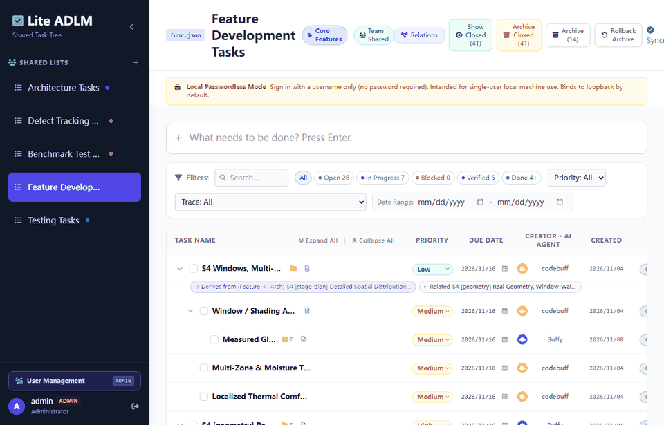
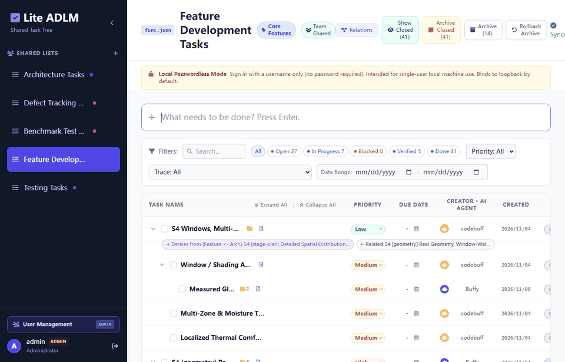

# Lite ADLM

**A shared task tree for humans and AI agents in Vibe Coding.**

Your agent writes the code. But where do the tasks live? In chat logs that scroll away, scratch `.md` files, and agent memory that resets. Lite ADLM gives you and your agent **one task tree to work from**: plain JSON files on disk, a pure-Python CLI, and an optional real-time board.



> Born from building complex simulation & engineering software, applying rigorous project management practices (hierarchical task trees, formal state machines, relationship graph traceability) to agent-driven development.

---

## The Problem

Vibe Coding shifts code generation to AI agents, but task management often stays ad hoc:

| Pain Point | What Happens in Practice |
|---|---|
| **Invisible** | You cannot see what the agent has completed or where it is stuck without scrolling chat history or asking for repetitive status summaries. |
| **Non-interruptible** | When you think of a new requirement mid-session, there is nowhere to land it — it gets washed away by context before the agent finishes. |
| **Non-shared** | Multiple agents or chat sessions maintain disconnected scratchpads; task statuses drift out of sync with no single source of truth. |
| **Non-traceable** | Why an engineering decision was made, and what benchmark evidence proves it works, cannot be audited after the session ends. |

---

## What Lite ADLM Gives You

- **One Source of Truth**: Humans use the browser board; agents use the CLI or HTTP API. Both read and write the exact same JSON files on disk.
- **Real-Time Visibility**: Tasks added or updated by an agent appear on the board instantly via live Socket.IO synchronization.
- **Interrupt Without Chaos**: Add tasks, adjust priorities, or leave notes while the agent is coding. It picks them up on its next query.
- **Traceable by Design**: Full state transition history, cross-category relations (`depends-on`, `verifies`, `blocks`), and graph gap analysis.
- **Safe for Agents**: Illegal transitions (e.g. `open → verified`) are rejected by a state transition guard. Concurrent writes via the HTTP API / board use optimistic concurrency (`baseRev` -> `409 Conflict`) to prevent lost updates; pure CLI file mode uses atomic temp-file replace to prevent file corruption (use the HTTP API for multi-writer safety).

---

## Real-World Case Study

### Developing a Multi-Physics Building Simulation Engine

Lite ADLM was developed and used during the implementation of a multi-physics building thermal and geometry simulation engine (featuring 3D building physics, non-linear airflow networks, and BIM IFC4 scene parsing).


*Board view showing active numerical simulation kernels and subtasks in the `func` category (from the author's simulation project task tree).*

> **Note**: The metrics, screenshot, and task items in this case study come from the author's private simulation project task tree. This repository intentionally ships clean seeds (`data/categories.json`) so your own project starts with a fresh, empty task board.

- **Scope**: 220+ task items across 5 categories (79 root tasks + 144 subtasks, including 102 archived items), spanning mathematical architecture (`arch`), numerical kernels (`func`), physics validation tests (`test`), analytical benchmark comparisons (`exam`), and defect tracking (`bug`).
- **The Challenge**:
  A common failure mode in multi-step AI agent workflows is declaring complex numerical features "complete" before end-to-end physical convergence is verified. Furthermore, as context grows long, agents easily lose track of boundary conditions and numerical constraints established in earlier turns without an external source of truth.
- **How Lite ADLM Addressed It**:
  1. **Rule-Based Verification Gates & Gap Analysis**: `SKILL.md` instructs the agent not to close a `func` task until an executed `test` or `exam` item records an inbound `verifies` link to it (with concrete convergence evidence, such as per-surface energy conservation residual $< 10^{-6}\text{ W/m}^2$). Running `python scripts/litetask_cli.py gaps` audits that contract across the task tree. On the author's task tree, it currently flags 69 `func` items with no recorded verification link (37 of them already marked done in code). That does not mean the code is untested — it means the evidence is not yet traceable in the graph. Because the skill rule is advisory rather than a tool hard-block, `gaps` turns missing evidence links into a visible backlog rather than a hidden assumption.
  2. **Mid-Session Task Insertion**: The board lets a human collaborator add, reprioritize, or annotate tasks while an agent is coding; the agent picks them up on its next query without breaking session flow.
  3. **Context Resilience**: Across long multi-session development cycles, task states, blocker reasons, and test evidence remained preserved on disk in plain JSON, without relying on ephemeral agent memory.

---

## How It Compares

| Dimension | Lite ADLM | GitHub Issues / Projects | Agent Built-in Todo | Local Notes / Scratchpad |
|---|---|---|---|---|
| **Storage & Setup** | Local JSON, zero config | Cloud-hosted, API key, auth | In-memory / context | Ad-hoc local files |
| **Shared Live View** | Instant Socket.IO board | Web UI, cloud-hosted | Agent-only internal | None (manual sync) |
| **Mid-Session Insertion** | Direct board edit | Cloud issue creation | Typically locked in loop | Prone to file overwrite |
| **Traceability Graph** | Built-in (`verifies`, `blocks`) | Sub-issues & dependencies | Typically flat checklist | None (manual notes) |
| **Gap Analysis** | Built-in CLI (`gaps`) | Custom scripts / Actions | Typically none built-in | None |
| **State Machine** | Enforced transition rules | Configurable workflow | Typically checkboxes only | Unenforced text |
| **Context Resilience** | Persistent on disk | Persistent in cloud | Varies (often wiped on reset) | Fragile manual upkeep |

**Use Lite ADLM when**:
- You are Vibe Coding with local AI agents (Claude Code, Cursor, or any agent capable of running shell commands) and want a zero-dependency, local-first task tree that you and your agent edit together on disk.
- You need engineering rigor: formal verification relations (`verifies`), blocker tracking, and CLI gap analysis (`gaps`) that surface features lacking verification evidence.

**Use something else when**:
- Your team already works entirely within GitHub Issues / Jira for public issue tracking, customer bug reports, or sprint planning across a large distributed team.
- You require enterprise multi-tenant permissions, fine-grained role-based access control (RBAC), or managed cloud infrastructure — Lite ADLM is intentionally local-first with a local trust model.

---

## Quick Start (30 seconds, Python only)

**Prerequisites**: Python 3.x (standard library only, zero pip dependencies; tested on 3.12; use `python3` if `python` is not mapped on your system).

```bash
git clone https://github.com/alainpdeai/lite-adlm-en.git lite-adlm
cd lite-adlm
python scripts/litetask_cli.py init    # One-time bootstrap (idempotent)
python scripts/litetask_cli.py add --category func --title "First Task" --agent "AI Agent"
python scripts/litetask_cli.py list --category func
```

Output:
```text
[mode=FILE]
[ ] First Task  P=Medium  S=open
```

No Node.js, no database, no build step. The CLI reads and writes the JSON task tree directly.

### Optional: Real-Time Web Board (Node.js ≥ 18)

```bash
npm install
npm start    # Open http://localhost:3000
```

When the board is running, the CLI routes through the REST API automatically — sharing the exact same live data as the browser. When the board server is down, the CLI transparently falls back to direct file I/O with zero feature loss.

> ⚠️ **Local Trust Security Model**: Regardless of authentication mode, Lite ADLM's Data APIs operate on a **local trust model** (trusting caller-supplied identity without validating cryptographic session tokens per data request). The default server binds strictly to loopback (`127.0.0.1:3000`), and `admin/admin` (`config/site.json`) is an initial local credential placeholder. **Never expose this service directly to untrusted networks or the public Internet.** For shared or remote access, place it behind an authenticating reverse proxy (e.g. Caddy/Nginx with TLS and auth). See [Security & Trust Boundaries](docs/security.md).

---

## How to Use in Your Own Project

You can integrate Lite ADLM into your existing codebase in one of three ways:

### Option A: Embed Directly in Your Repository (Best for a single project repo tracking its own tasks)
Create the target folders and copy the CLI, category config, and skill prompt into your project:

```bash
# Inside your own project repository:
mkdir -p scripts data
cp /path/to/lite-adlm/scripts/litetask_cli.py ./scripts/
cp /path/to/lite-adlm/data/categories.json ./data/
cp /path/to/lite-adlm/SKILL.md ./
python scripts/litetask_cli.py init
```

Tasks are stored in `./data/shared_lists/`. *(Note: If your project already has a `./data/` folder, Lite ADLM stores all task lists neatly inside the `shared_lists` subfolder).*

### Option B: Use as a Sidecar / Central Hub (Best for multiple repos sharing one central task board)
Keep `lite-adlm` in a separate folder and start its web server (`npm start`). From any of your other project repositories, your agent runs:
```bash
python /path/to/lite-adlm/scripts/litetask_cli.py list
```
The CLI automatically targets `lite-adlm`'s task tree: in API mode when the server is running on `http://localhost:3000`, or direct file I/O if the server is stopped. (Use `--root <dir>` only if you want the script to point to a different task tree location).

### Option C: Skill Package for AI Agents
For agent environments that support custom skill directories (e.g. Claude Code skills, Antigravity skills), you can drop `dist/skill/LiteADLM/` directly into your agent's skills folder.

---

## Connect Your Agent

Lite ADLM connects to your AI agent workflows via its CLI. Point your agent at [`SKILL.md`](SKILL.md), which defines how it queries, claims, and updates tasks.

### 1. Claude Code (`CLAUDE.md`)
Add this snippet to your project's `CLAUDE.md`:
*(Note: If you use Option B, replace `./scripts/litetask_cli.py` with the path to your lite-adlm installation, e.g. `/path/to/lite-adlm/scripts/litetask_cli.py`)*

```markdown
## Task Tracking (Lite ADLM)
Use the local task tree in `./scripts/litetask_cli.py` for task management:
- Query open tasks: `python scripts/litetask_cli.py list --category func`
- Claim a task: `python scripts/litetask_cli.py status --category func --title-or-id "<id_or_title>" --status in-progress`
- Record blocked state: `python scripts/litetask_cli.py status --category func --title-or-id "<id_or_title>" --status blocked --reason "<cause>"`
- Link test verification: `python scripts/litetask_cli.py link --category test --title-or-id "<test_id>" --relates func:<func_id>:verifies`
- Mark QA verified: `python scripts/litetask_cli.py status --category func --title-or-id "<id_or_title>" --status verified`
- Close task: `python scripts/litetask_cli.py status --category func --title-or-id "<id_or_title>" --status done`
- Check unverified features: `python scripts/litetask_cli.py gaps`
Rule: Never mark a feature done without linking or verifying its test evidence. See SKILL.md for complete syntax.
```

### 2. Cursor (`.cursor/rules/litetask.mdc` or `.cursorrules`)
*(Example template — adapt to your agent's rule format)*

```markdown
You collaborate with the user on a shared task tree.
Before starting complex multi-step work:
1. Run `python scripts/litetask_cli.py list` to check active tasks and blockers.
2. Mark your claimed task `in-progress` via `python scripts/litetask_cli.py status --category <cat> --title-or-id "<id>" --status in-progress`.
3. Link test verification: `python scripts/litetask_cli.py link --category test --title-or-id "<test_id>" --relates func:<func_id>:verifies`.
4. Transition to `verified` before closing with `done`.
```

### 3. Aider / General Agents (`AGENTS.md`)
*(Example template — adapt to your agent's rule format)*

```markdown
Use `python scripts/litetask_cli.py` (pure Python standard library) to query and update the project task tree.
Consult `SKILL.md` for complete command syntax, relation edge rules, and status criteria.
```

---

## How It Works

```text
Human adds task on board  ──┐
                            ├──▶  Task tree (JSON on disk)  ◀──  Agent claims, updates, records evidence
Agent adds task via CLI  ───┘                  │
                                               ▼
                                 Real-time board · history · relations · archive
```

- **Five Standard Lists**: `arch` (Architecture), `func` (Core Features), `test` (Testing & QA), `exam` (Benchmarks), `bug` (Defect Tracking). Configurable via `data/categories.json`.
- **State Flow**: `open → in-progress / blocked → verified → done` (direct close from any active state is permitted; skips such as `open → verified` are rejected).

---

## Documentation Index

- [Core Concepts](docs/concepts.md): Task tree layout, state machine lifecycle, relationship edges, optimistic concurrency.
- [Archiving, Pruning & Backups](docs/archiving.md): Two-phase transactional archiving, snapshot rollback, automated rolling backups.
- [Teams & Accounts](docs/accounts.md): Attribution, agent identities, scrypt authentication, session management.
- [Security & Trust Boundaries](docs/security.md): Network surface (127.0.0.1 default), CSP, same-origin vendoring, filesystem whitelists.
- [REST API Reference](docs/api.md): Complete endpoint parameters, payload formats, and status codes.
- [Quality Gates & Verification](docs/quality.md): Test suite architecture, automated graders, line-ending guards.
- [Task Taxonomy Implementation Guide](docs/task_taxonomy_guide.md): Guide for custom L1/L2 domain dictionaries.
- [Test Case Matrix](docs/test_case_matrix.md): Functional coverage matrix for all test assets.
- [Installation Guide](install.md): Full deployment, interactive wizard, and configuration reference.

---

## Quality Gates

The test suite includes automated graders verifying concurrency, state transitions, archiving integrity, and security boundaries.

> ℹ️ **Prerequisites**: Run `python scripts/litetask_cli.py init` first to initialize lists. Graders verifying HTTP API endpoints, password hashing, and concurrency require the Node server to be running (`npm start`), and the git baseline grader requires `core.autocrlf=false`.

```bash
# 1. Install dependencies, initialize lists, and start server in background
npm install
python scripts/litetask_cli.py init   # Creates data/shared_lists/ (needed by backup grader)
npm start &                           # Required for HTTP API & concurrency graders (on Windows, run in separate terminal)
git config core.autocrlf false        # Required by git baseline grader

# 2. Run fast grading subset (13 core graders) (~20s on Linux)
python tests/run_grade_checks.py --fast
# Expected: 13/13 passed (verified on Ubuntu, Python 3.12, Node 22)

# 3. Optional: Run full test suite & read-only validation
python tests/run_grade_checks.py
npm run validate
```

---

## License

[Apache License 2.0](LICENSE).
